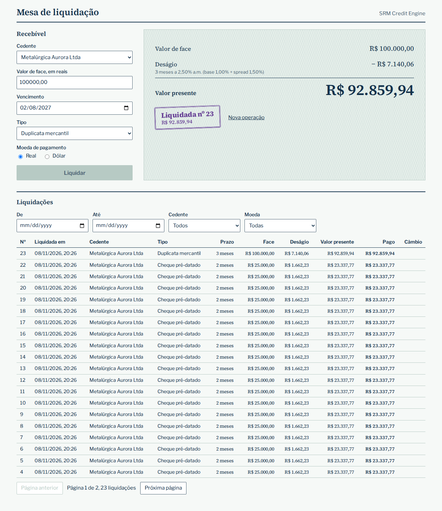
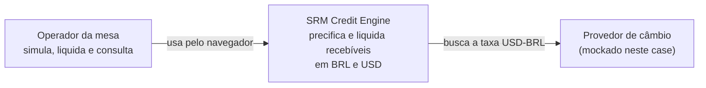
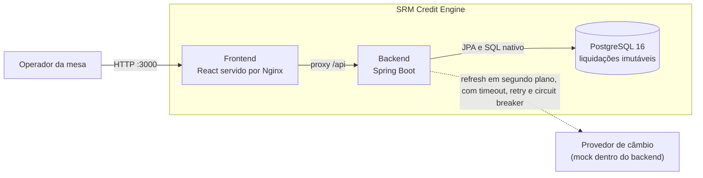
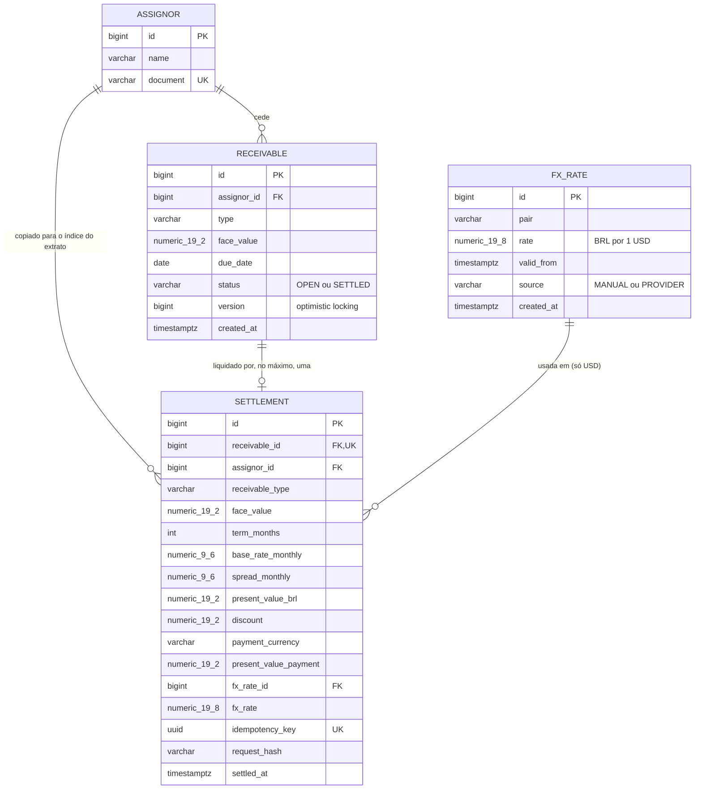

# SRM Credit Engine

Motor de precificação e liquidação de recebíveis para um FIDC com caixa em BRL e USD. A mesa simula o valor presente de um título, liquida com segurança (atômico, idempotente e imutável) e consulta o extrato.



## Como rodar

Só precisa de Docker:

```bash
docker compose up -d --build
```

| O quê | Onde |
|---|---|
| Painel do operador | http://localhost:3000 |
| API | http://localhost:8080 |
| Swagger UI | http://localhost:8080/swagger-ui.html |
| Health | http://localhost:8080/actuator/health |
| Métricas | http://localhost:8080/actuator/prometheus |

Migrations, cedentes e a taxa de câmbio entram sozinhos na subida. `docker compose down -v` zera o banco. Para usar outras credenciais, copie `.env.example` para `.env`.

Para ver a resiliência do câmbio:

```bash
FX_MOCK_FAIL=true docker compose up -d backend    # ou FX_MOCK_DELAY=PT5S
curl -i -X POST http://localhost:8080/api/fx-rates/refresh    # 503 com Retry-After
```

## Documentos

| Arquivo | Conteúdo |
|---|---|
| [`SPEC.md`](SPEC.md) | Premissas, perguntas ao negócio e decisões de precisão numérica |
| [`REVIEW.md`](REVIEW.md) | Code review do Anexo A, em ordem de severidade |
| [`DECISIONS.md`](DECISIONS.md) | O que foi cortado ou simplificado, e por quê |
| [`AI_USAGE.md`](AI_USAGE.md) | Como a IA foi usada, com o log do que errou |
| [`docs/acceptance/`](docs/acceptance/README.md) | Critérios de aceite, cada um ligado ao seu teste |
| [`docs/perf/REPORT.md`](docs/perf/REPORT.md) | Resultado da carga e do estresse |
| [`docs/prs/`](docs/prs) | Descrição de cada PR, com o porquê |

## Stack

| Escolha | Por quê |
|---|---|
| **Java 21 e Spring Boot 3.5** | Tipagem forte e `BigDecimal` nativo, em um framework maduro para ambiente financeiro. `DECISIONS.md` explica por que não migrar para a 4.x. |
| **PostgreSQL 16 e Flyway** | `NUMERIC` exato, transações ACID, e triggers e `CHECK` que protegem o dado de qualquer cliente, não só da aplicação. |
| **Spring Data JPA nas escritas, `JdbcTemplate` no extrato** | `@Version` dá optimistic locking de graça. O relatório precisa de SQL controlado, com índices. |
| **Resilience4j programático** | Timeout, retry e circuit breaker na integração de câmbio, em ordem visível no código. |
| **Actuator, Micrometer e logs ECS** | Métricas de negócio e logs JSON sem dependência extra de logging. |
| **React 18, TypeScript estrito e Vite** | Tipagem também no cliente. Dinheiro é `string` nos tipos, e o `decimal.js` entra só onde há conta. |
| **TanStack Query e React Hook Form com Zod** | Estado do servidor e do formulário sem escrever cache nem validação à mão. **Sem Redux:** os filtros ficam na URL, e não sobra nada para um estado global. |
| **Nginx na frente do build** | Serve os estáticos e faz proxy de `/api`. Mesma origem, sem CORS. |

## Arquitetura

### C4 nível 1: contexto



### C4 nível 2: contêineres



A seta tracejada é a decisão central da resiliência: **a liquidação nunca chama o provedor**. Ela lê a taxa vigente do banco. Se o provedor cair, a liquidação em USD segue até a taxa vencer e depois recusa com `503`. BRL não é afetado.

### Modelo de dados



`settlement` e `fx_rate` têm trigger que bloqueia `UPDATE`, `DELETE` e `TRUNCATE`: alterar uma liquidação não é uma operação do sistema.

## Qualidade e testes

```bash
cd backend && ./mvnw verify                  # unitários, integração, contrato, cobertura e Spotless (precisa de Docker)
cd backend && ./mvnw -q test -Dtest=GoldenCasesTest   # só os golden cases
cd frontend && npm ci && npm run lint && npm run build
scripts/verify-all.sh                        # tudo, a partir de um banco zerado
```

| Camada | Ferramenta | Pega |
|---|---|---|
| Unitário | JUnit 5 e AssertJ, sem Spring | Erro de cálculo, arredondamento, regra de strategy |
| Integração | Testcontainers com Postgres real | Transação, idempotência, locking, trigger, SQL do extrato |
| Contrato | `swagger-request-validator` contra `/v3/api-docs` | API divergindo do OpenAPI publicado |
| E2E | Playwright contra o compose | Painel, liquidação e grid quebrados de ponta a ponta |
| Carga e estresse | k6 e checagem de integridade em SQL | Regressão de latência e corrupção de dados sob pressão |

**Cobertura real (unitários e integração mesclados, de `target/site/jacoco-merged/jacoco.csv`):** 98,5% de linhas no projeto; 100% de linhas e de branches em `domain.pricing`. O build falha abaixo de 70% de linhas no projeto ou de 90% de linhas e branches em `domain.pricing`.

Carga e estresse rodam localmente, não no CI, e os números estão em [`docs/perf/REPORT.md`](docs/perf/REPORT.md).

## Mapa do repositório

```text
backend/src/main/java/br/com/srm/creditengine/
  api/              controllers, DTOs (records), ApiExceptionHandler, OpenAPI, filtro de payload
  application/      casos de uso: SettlementService, QuoteService, FxRateService, ReceivableService
  domain/           Java puro, sem Spring
    pricing/        PricingEngine, strategies, MonetaryPolicy, TermCalculator
    model/          enums do negócio
  infrastructure/
    persistence/    entidades, repositórios e StatementQuery (SQL nativo)
    fx/             MockFxRateProvider, ResilientFxRateClient, FxRateRefreshJob
    config/         propriedades e configuração do Spring
backend/src/main/resources/db/migration/   schema, trigger de imutabilidade e seed
frontend/src/
  features/operator/    painel: formulário, simulação e intenção de liquidação
  features/statement/   grid e filtros na URL
  lib/                  cliente da API e formatação de dinheiro
frontend/e2e/           fluxo do operador (Playwright)
perf/                   scripts k6, seed, integridade e gerador do relatório
scripts/verify-all.sh   critério de saída: build, compose, smoke, E2E, carga, estresse e integridade
docs/acceptance/        critérios de aceite
docs/perf/              resultados reais de carga e estresse
docs/prs/               descrição de cada PR
```

## Git

**GitHub Flow:** `main` sempre verde, uma branch curta por etapa e PR com CI verde antes do merge. É um projeto de uma pessoa, com entrega contínua e sem releases paralelas: Git Flow seria cerimônia sem benefício aqui. Os commits seguem Conventional Commits, e cada PR explica o porquê.
